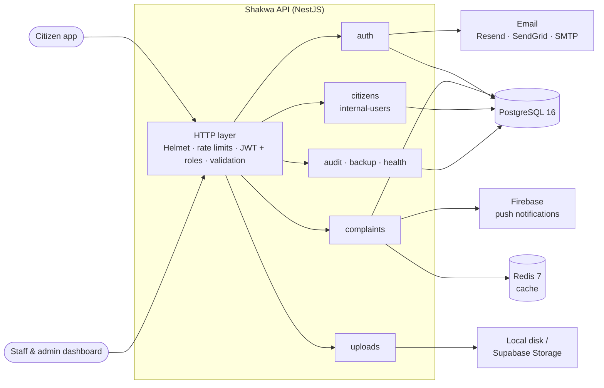
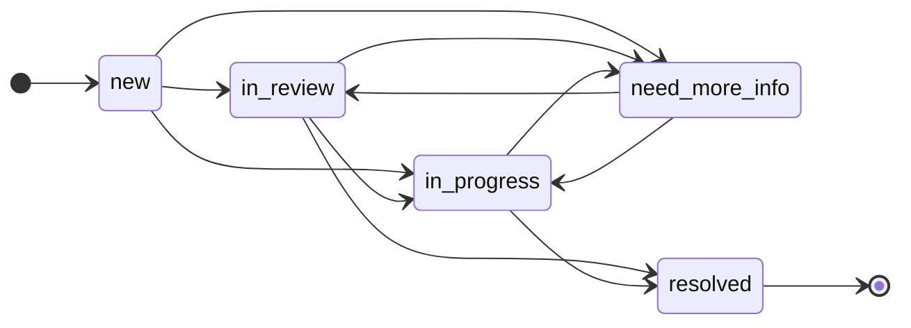

<div align="center">

# Shakwa · شكوى

**Backend API for a government complaints platform.**<br/>
Citizens file complaints about public services, each authority's staff handle them, and
administrators oversee the whole system.


[Highlights](#highlights) · [Architecture](#architecture) · [Complaint lifecycle](#complaint-lifecycle) ·
[API](#api-overview) · [Getting started](#getting-started) · [Deployment](#deployment)

</div>

---

**Shakwa** (Arabic for *complaint*) was built as the course project for **Internet Applications**
at the **University of Damascus**. It is a modular NestJS application backed by PostgreSQL and
Redis. The repository also includes a Docker setup, Kubernetes manifests and load tests.

## Highlights

- **Three roles, one API.** Citizens sign up with an emailed verification code and manage their
  own complaints. Each staff account belongs to one government authority and sees only that
  authority's complaints. Admins see everything and manage staff, citizens, audit logs and
  backups.
- **Routed to the right authority.** Each complaint targets one of 20 authorities (the
  municipality, the electricity and water companies, public hospitals and schools, the traffic
  police and others) and carries one of 10 categories used for statistics.
- **No conflicting edits.** A user must lock a complaint before changing it. The lock lasts
  10 minutes and is taken inside a `pessimistic_write` transaction, so two people can't edit the
  same complaint at once. Logging out releases every lock the user holds.
- **Controlled lifecycle.** Status changes must follow a fixed transition table. Every change is
  saved to the complaint's history, and the citizen gets a push notification in Arabic or
  English.
- **Redis caching.** Complaint responses are cached for 5 minutes. Every write clears the
  affected entries by tag.
- **Audit trail and backups.** A global interceptor logs who did what. `pg_dump` takes a database
  backup every 7 days and keeps the latest 10. Admins can create, download, restore and delete
  backups through the API.
- **Safe file uploads.** Each file's type is checked against its magic bytes, not just its
  extension. Images are re-encoded with Sharp (WebP first, quality 80). Files are stored on local
  disk or in Supabase Storage.
- **Hardened HTTP layer.** JWT access and refresh tokens, bcrypt, Helmet and compression. A
  global rate limit applies everywhere. Email verification, code checks and password reset have
  stricter limits. Zod validates the
  environment at startup.
- **Bilingual.** Validation messages and notifications are in Arabic and English. The language
  comes from `?lang=`, the `x-lang` header or `Accept-Language`.

## Architecture



### Roles

| Role | Account | Can do |
|---|---|---|
| **Citizen** | Registers with an emailed verification code | File complaints with attachments, follow their status and history, edit them while holding the lock, manage the profile |
| **Staff** | Created by an admin and tied to one authority | List and handle that authority's complaints, change their status, view statistics for the authority |
| **Admin** | Seeded super admin, plus accounts created by admins | Everything staff can do, for all authorities, plus managing staff and citizens (block / unblock), the audit log and backups |

### Project structure

```text
src/
├── common/              guards, decorators, interceptors, middlewares, pipes, pagination, health
├── modules/
│   ├── auth/            citizen and staff/admin sign-in, verification and password reset
│   ├── citizens/        citizen profiles and admin management
│   ├── internal-users/  staff and admin accounts
│   ├── complaints/      role-based services, locking, caching, status notifications
│   ├── uploads/         file upload endpoints
│   ├── audit/           audit interceptor, log queries and statistics
│   └── backup/          scheduled and manual pg_dump backups
├── shared/
│   ├── exceptions-filter/  global exception filter with per-error strategies
│   ├── modules/            config (Zod), i18n, JWT, logger (Winston), throttler, TypeORM
│   └── services/           mail, notifications, redis, storage
└── scripts/seeds/       admins, staff, citizens and sample complaints
env/                     .env (shared) and .env.<NODE_ENV>
k8s/                     Kubernetes manifests and helper scripts
jmeter-load-test/        JMeter test plan
k6-load-test.js          k6 load test
```

## Complaint lifecycle



An open complaint can also move to `rejected` or `cancelled` from any of the four open states.
`resolved`, `rejected` and `cancelled` are final.

## API overview

Every route is served under `/api`. Versioning is URI-based: `GET /api/v1/citizen/complaints/:id`
and `GET /api/v2/citizen/complaints/:id` are served side by side.

| Area | Base path | Access | Endpoints |
|---|---|---|---|
| Citizen auth | `/auth/citizens` | Public (logout: citizen) | `send-verification-email` · `verify-code` · `register` · `login` · `logout` · `forgot-password` · `verify-reset-code` · `reset-password` |
| Staff & admin auth | `/auth/internal-users` | Public (logout: staff, admin) | `login` · `logout` · `forgot-password` · `verify-reset-code` · `reset-password` |
| Citizen profile | `/citizens/me` | Citizen | get · update · delete |
| Citizen complaints | `/citizen/complaints` | Citizen | create · list · get · update · lock |
| Staff complaints | `/staff/complaints` | Staff | list · get · update · lock · statistics |
| Admin complaints | `/admin/complaints` | Admin | list · get · update · lock · statistics |
| Citizen management | `/admin/citizens` | Admin, staff | list · get · block · unblock |
| Staff & admin accounts | `/internal-users` | Admin (own profile: staff) | create · list · get · update · delete · `me` |
| Files | `/upload` | No auth guard | `single` · `multiple` · `any` · `grouped` · delete · signed URLs |
| Audit log | `/audits` | Admin | list · `stats` |
| Backups | `/backups` | Admin | `status` · list · create · restore · download · delete · cleanup |
| Health | `/health` · `/health/live` · `/health/ready` | Public | Kubernetes probes (`ready` also checks the database) |

**Conventions**

- Requests may use `snake_case`. Bodies and query strings are converted to camelCase on the way
  in, and the `data` in each response is returned in `snake_case`.
- Every successful response has the same envelope:

  ```json
  {
    "data": { "id": 42, "status": "in_review", "authority": "water_company", "created_at": "…" },
    "meta": {
      "message": "Data retrieved successfully",
      "statusCode": 200,
      "status": "success",
      "path": "/api/citizen/complaints/42",
      "method": "GET",
      "requestId": "…",
      "podName": "shakwa-backend-…",
      "timestamp": "2026-01-11T16:56:51.000Z"
    }
  }
  ```

  List endpoints add a `pagination` object. `podName` shows which replica answered, which is
  useful when testing the load balancer.
- Errors come from one global exception filter as `{ statusCode, errors, message }`, and the
  message is translated.

## Getting started

### Prerequisites

- Node.js 22 and npm
- Either Docker, or a local PostgreSQL 16 and Redis 7
- `pg_dump` on the `PATH` if you want to use the backup module

### Configuration

Configuration lives in `env/`. `env/.env` holds shared values, and `env/.env.<NODE_ENV>`
(`development`, `production` or `test`) holds the values for one environment. Every variable is
validated with Zod at startup, so a missing or malformed value stops the app with a clear error.

| Group | Variables |
|---|---|
| Server | `PORT`, `NODE_ENV`, `APP_NAME` |
| Database & cache | `POSTGRES_HOST`, `POSTGRES_PORT`, `POSTGRES_USER`, `POSTGRES_PASSWORD`, `POSTGRES_DATABASE`, `REDIS_URL` |
| JWT | `JWT_ACCESS_SECRET`, `JWT_ACCESS_EXPIRES_IN_S`, `JWT_REFRESH_SECRET`, `JWT_REFRESH_EXPIRES_IN_S`, `JWT_SECURITY_SECRET`, `JWT_SECURITY_EXPIRES_IN_S` |
| Mail | `MAIL_PROVIDER` (`resend`, `sendgrid` or `smtp`), `RESEND_API_KEY`, `SENDGRID_API_KEY`, `SMTP_HOST`, `SMTP_PORT`, `SMTP_USER`, `SMTP_PASS`, `SMTP_FROM` |
| Storage & push | `BASE_PATH`, `SUPABASE_URL`, `SUPABASE_SERVICE_ROLE_KEY`, `SUPABASE_BUCKET`, `BACKUP_STORAGE_FOLDER`, `FIREBASE_SERVICE_ACCOUNT` |
| Rate limiting | `RATE_LIMIT_TTL`, `RATE_LIMIT_MAX` |
| Logging | `LOG_LEVEL`, `LOG_DIR`, `LOG_CONSOLE`, `LOG_HTTP`, `LOG_MAX_SIZE`, `LOG_MAX_FILES`, `LOG_ERROR_MAX_FILES`, `LOG_ZIP_ARCHIVE`, `LOG_SLOW_REQUESTS`, `LOG_SLOW_REQUEST_THRESHOLD` |
| Seeding | `SUPER_ADMIN_PASSWORD` |

### Run with Docker Compose

```bash
docker compose up -d --build
```

This starts the API on `http://localhost:3000/api`, along with PostgreSQL, Redis, and pgAdmin
on `http://localhost:5050`. The API container reads `env/.env.development` and `env/.env`, and
Compose points it at the bundled database and Redis.

### Run locally

```bash
npm install
npm run start:dev     # watch mode on http://localhost:3000/api
npm run seed:dev      # optional: demo data
```

The seed creates the super admin `admin@shakwa.com`, whose password is `SUPER_ADMIN_PASSWORD`. It
also adds staff accounts, citizens and sample complaints.

### Scripts

| Command | What it does |
|---|---|
| `npm run start:dev` | Start in watch mode (`NODE_ENV=development`) |
| `npm run start:debug` | Start with the debugger attached |
| `npm run build` | Compile to `dist/` |
| `npm run start:prod` | Run the compiled app (`NODE_ENV=production`) |
| `npm run seed:dev` / `seed:prod` | Build, then seed the database |
| `npm run i18n:check` | Validate the Arabic and English translation files and regenerate their types |
| `npm run lint` / `format` | ESLint and Prettier |

## Deployment

### Docker image

The `Dockerfile` has two stages on `node:22-alpine`. The first stage builds the app. The second
installs production dependencies only, copies `dist/` and runs `node dist/main.js` on port 3000.

`.gitlab-ci.yml` builds the image with a BuildKit layer cache, pushes `shakwa-api:latest` and
`shakwa-api:<commit-sha>` to Docker Hub, and then triggers a redeploy on Koyeb. The pipeline is
set to run on the `docker` branch.

### Kubernetes

The manifests in `k8s/` describe a production-style deployment in the `shakwa` namespace:

| Manifest | What it sets up |
|---|---|
| `deployment.yaml` | 5 replicas with rolling updates. Startup, liveness and readiness probes. Non-root containers with a `RuntimeDefault` seccomp profile. Pod anti-affinity across nodes and zones. Prometheus annotations |
| `hpa.yaml` | Autoscaling from 3 to 15 pods on CPU (70%) and memory (80%) |
| `pdb.yaml` | A pod disruption budget that keeps the API available during node maintenance |
| `network-policies/` | Deny all traffic by default, then allow the ingress controller, external egress and Prometheus scraping |
| `resource-quota.yaml` · `limit-range.yaml` | Resource limits for the namespace and defaults for each container |
| `ingress.yaml` · `cluster-issuer.yaml` | Ingress with a cert-manager issuer for TLS |
| `configmaps/` · `secrets/` | App, logging and rate-limit settings, plus database, Redis, JWT and API-key secrets |

To try it on minikube:

```bash
minikube image build -t shakwa:latest .
./k8s/scripts/up.sh       # apply every manifest in order
./k8s/scripts/run.sh      # print the service URL
./k8s/scripts/lb-test.sh  # send requests and see which pods answered
./k8s/scripts/down.sh     # remove everything
```

## Load testing

| Tool | Scenario |
|---|---|
| [k6](https://k6.io) | `k6-load-test.js` ramps up to 100 virtual users who list, filter, create and read complaints. It fails if p95 latency is above 500 ms or p99 is above 1 s. Paste a citizen token into the script, and set `BASE_URL` to test a target other than `http://localhost:3000/api`. |
| [Apache JMeter](https://jmeter.apache.org) | `jmeter-load-test/shakwa.jmx` sends 100 concurrent threads at the admin complaint list and lock endpoints. |

```bash
k6 run k6-load-test.js
jmeter -n -t jmeter-load-test/shakwa.jmx -l results.jtl
```

## Tech stack

**NestJS 11** · TypeScript 5 · Node.js 22 · TypeORM · PostgreSQL 16 · Redis 7 (ioredis) ·
Passport JWT · class-validator · Zod · Winston · nestjs-i18n · Sharp · Supabase Storage ·
Firebase Admin · Resend / SendGrid / SMTP · Docker · Kubernetes · GitLab CI · k6 · JMeter

---

<div align="center">
<sub>Internet Applications course project · University of Damascus</sub>
</div>
